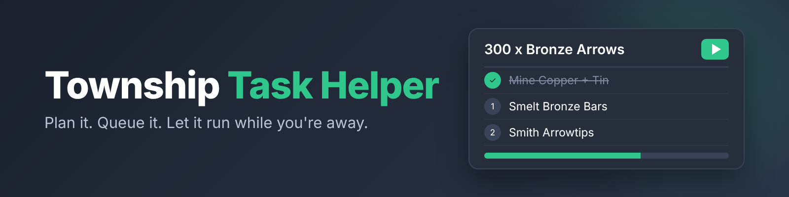

# Township Task Helper

Township tasks take a lot of planning. Which ore, how many bars, which arrows, which monster, what level. Township Task Helper plans every task for you, then sends the steps to your queue so you can walk away.

## Before you install

Township Task Helper needs two other mods to work:

- Action Queue, which holds your queue and runs the steps
- Skill Trainer, which knows how to train each skill

Install both, then Task Helper. Without them Task Helper shows a warning and stops.

## Getting started

Open Township and go to your task list. Every requirement has a green play button next to it. Click one and you're in.

## One click, full plan

Every task in your Township list gets a green play button. Press it and you see the steps in order for exactly what you still need. Already have the logs? That step is skipped. Not high enough level? You find out right away, before you spend an hour on it. Short on feathers? Buy them from the same window.

## Stardust, handled

Stardust and Golden Stardust drop while you study a constellation in Astrology. When a task needs them, the plan takes you there and asks which constellation you want to study, since each one boosts different skills. Pick the one you care about, or let it use the best XP per hour.

## Drops, sorted out

Some items only drop. Bird Nest comes from Woodcutting, Bones from monsters. When a task needs one, the plan picks the quickest way: a skill you can train while it drops, or a fight that's safe for your health and food. The queue only runs fights that are safe while you're away. It checks your Slayer task too, and offers it when that monster drops what you need. You can always pick a different tree or monster yourself.

## Walk into fights ready

Monster tasks show how the enemy attacks, what it's weak to and where to find it. You can check your food and swap equipment sets without closing the window.

## Let it run

Add a plan to your queue and walk away. It gathers, crafts, trains, fights and even plants and harvests crops, one step after another, and pauses with a note if something needs you. Start it before bed and wake up to finished tasks.

The queue lives in Action Queue, so Task Helper and Skill Trainer share one list and one panel.

## Small things that save time

- XP tasks pick the best method you can actually use and switch as you level up
- It won't queue the same step twice
- If it can't find where an item comes from, it points you to the wiki

## Bugs and ideas

Found a bug or have an idea? Open an issue. For a bug, say which task or item it happened on and what you expected to see.

## License

MIT, see [LICENSE](LICENSE).
